<<<<<<< HEAD
# FastAPI Docs Q&A — a RAG chatbot with verifiable citations

A question-answering chatbot over the [FastAPI documentation](https://fastapi.tiangolo.com/). It answers **only** from the docs, cites the passage behind every claim, and says *"I don't have enough information"* when the docs don't cover a question.

The point of this project isn't just the chatbot — it's the **evaluation loop** around it: a 34-question test set, retrieval and answer-quality metrics, and four measured improvements.

## How it works

```mermaid
flowchart LR
    A[FastAPI docs<br/>153 pages] --> B[load.py<br/>clean + inline code]
    B --> C[chunking.py<br/>split on headings]
    C --> D[(Chroma<br/>1,791 chunks)]
    Q[Question] --> E[Vector search<br/>top 20]
    D --> E
    E --> F[Cross-encoder<br/>rerank → top 5]
    F --> G[Add sibling chunks<br/>from top pages]
    G --> H[Claude<br/>answer with &#91;n&#93; citations]
    H --> I[Citation check<br/>every &#91;n&#93; must exist]
    I --> J[Answer + sources]
```



1. **Ingest** — load the markdown pages, replace the docs' `{* ../../docs_src/... *}` placeholders with the real code files, drop the release notes.
2. **Chunk** — split on `#`/`##`/`###` headings (ignoring `#` lines inside code fences), cap chunks at ~2,000 characters with overlap, and prefix each chunk with `Page > Section`.
3. **Index** — embed chunks locally with `all-MiniLM-L6-v2` and store them in a persistent Chroma collection with URL, title and heading metadata.
4. **Retrieve** — vector search for 20 candidates, re-score them with a cross-encoder (`ms-marco-MiniLM-L-6-v2`), keep the best 5, then append the sibling chunks of the top 2 pages so code examples travel with their explanation.
5. **Answer** — Claude gets the numbered passages and strict rules: answer only from them, cite as `[n]`, refuse if the passages don't contain the answer.
6. **Verify** — the code extracts every `[n]` from the answer and checks it against the passages actually sent. Only cited passages are shown as sources; an unknown citation raises a warning.

## Results

Evaluated on 30 in-scope questions (each labelled with the page that should answer it) plus 4 out-of-scope questions that should be refused.

### Retrieval (free to run, no API calls)

| Run | Change | hit@5 | hit@1 | MRR |
|---|---|---|---|---|
| baseline | vector search only | 0.933 | 0.667 | — |
| no_release_notes | dropped changelog pages | 0.933 | 0.700 | 0.792 |
| rerank | + cross-encoder reranker | 0.933 | 0.800 | 0.858 |
| inline_code | + real code in chunks | **0.967** | 0.800 | **0.878** |

### Answer quality (LLM judge, 1–5)

| Run | Config | Faithfulness | Relevance | False refusals | Out-of-scope refused |
|---|---|---|---|---|---|
| full_best | rerank + inlined code | 4.88 | 4.54 | 1 | 4/4 |
| **full_expand** | + sibling chunks | **4.96** | **4.89** | 1 | 4/4 |

### Metrics explained

- **hit@k** — fraction of questions where the correct page appears in the top *k* retrieved chunks.
- **MRR** (mean reciprocal rank) — average of 1/rank of the correct page: 1.0 if always first, 0.5 if second, and so on.
- **Faithfulness** — does every claim in the answer appear in the retrieved passages? (catches invented content)
- **Relevance** — does the answer actually address the question?
- **Out-of-scope refused** — unrelated questions (capital of France, PyTorch, Django, pizza) that must get "I don't have enough information".
- **False refusals** — in-scope questions the system wrongly refused.

## What the evaluation taught me

- **Noise pages hurt ranking.** The release notes mention every feature, so they outranked real tutorial pages. Removing them helped.
- **A reranker sharpens the top result.** Reordering 20 candidates with a cross-encoder raised hit@1 from 0.70 to 0.80 at no API cost, but cannot recover pages the first search missed (hit@5 stayed flat).
- **Missing code is invisible to retrieval metrics.** The docs pull code in through placeholders, so chunks had explanations but no examples. Inlining the real files recovered one missed page.
- **Page-level metrics hid a chunk-level problem.** `hit@5` counts a page as found if *any* of its chunks is retrieved — including chunks without the answer. The LLM judge exposed this: answers kept saying "the code example isn't in the passages", dragging relevance to 4.54. Appending the top pages' sibling chunks lifted relevance to 4.89 without hurting faithfulness.
- **Failing safe is a feature.** The one remaining miss ("how do I read custom request headers?") returns a refusal rather than a wrong answer.

## Run it

Requires Python 3.10+ and an [Anthropic API key](https://console.anthropic.com/). Developed on Windows/PowerShell; run every command from the project folder.

```powershell
python -m venv .venv
.venv\Scripts\Activate.ps1
pip install -r requirements.txt

cp .env.example .env            # then put your key in .env

mkdir data
git clone --depth 1 https://github.com/fastapi/fastapi data/fastapi

python load.py                  # docs -> data/docs.jsonl
python build_index.py           # chunk + embed -> chroma_db/
python rag.py "How do I run background tasks?"
```

Chat UI (two terminals, venv active in both):

```powershell
uvicorn api:app --reload        # terminal 1: API on :8000 (try /docs)
streamlit run app.py            # terminal 2: chat UI on :8501
```

Evaluate:

```powershell
python eval.py --label my_run --retrieval-only    # free, retrieval metrics only
python eval.py --label my_run                     # full run, ~$0.5–1 in API credit
```

`RERANK` and `EXPAND` default to on. Set `RERANK=0` / `EXPAND=0` in the environment to reproduce the baseline. Each run appends a row to `eval_results/summary.csv`.

## Project layout

| File | Purpose |
|---|---|
| `load.py` | Clean docs, inline code placeholders, write `data/docs.jsonl` |
| `chunking.py` | Heading-aware chunking rules |
| `build_index.py` | Embed chunks and store them in Chroma |
| `rag.py` | Retrieval, reranking, expansion, Claude call, citation check |
| `api.py` | FastAPI endpoint (`POST /ask`) |
| `app.py` | Streamlit chat UI with expandable source snippets |
| `test_search.py` | Quick retrieval check from the command line |
| `eval.py`, `eval_questions.json` | Evaluation harness and labelled question set |
| `eval_results/` | Saved results and `summary.csv` |

## Limitations

- **Small eval set.** With 30 in-scope questions, one question moves a score by 0.033. Differences between runs are directional, not statistically significant.
- **Tuned on the test set.** The improvements were chosen while looking at these same questions, so scores are probably optimistic. A held-out set is the next step.
- **Self-grading.** Claude judges Claude's answers, so the 1–5 scores are best used to compare runs, not as absolute quality. The judge's context limit was raised from 12,000 to 30,000 characters between the last two runs, a small confound.
- **Page-level retrieval labels.** Each question has one correct page; some questions (e.g. test client, status codes) are legitimately answered by more than one.
- **Code inlining is approximate.** Placeholders pull the whole example file (first 60 lines) and ignore line-range hints.
- **One known miss.** "How do I read custom request headers?" retrieves response-header pages instead of the request-header tutorial.

## Stack

Python · Chroma · sentence-transformers (embeddings + cross-encoder reranker) · Anthropic API (Claude Sonnet) · FastAPI · Streamlit
=======
# Project---AI---1
First Hands on Project on - AI
>>>>>>> b15f47435d4fd5b56a1b5fc66748bb2101f4f7d0
